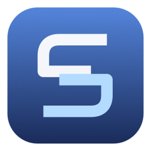
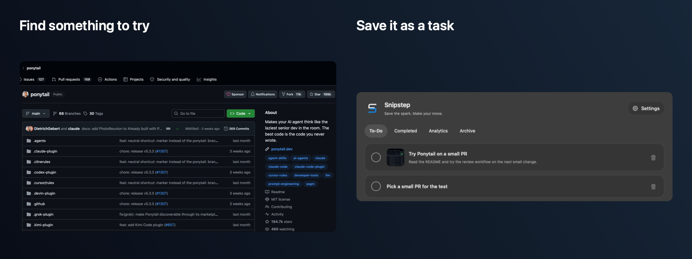
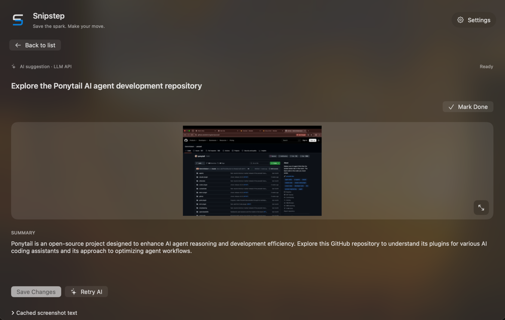
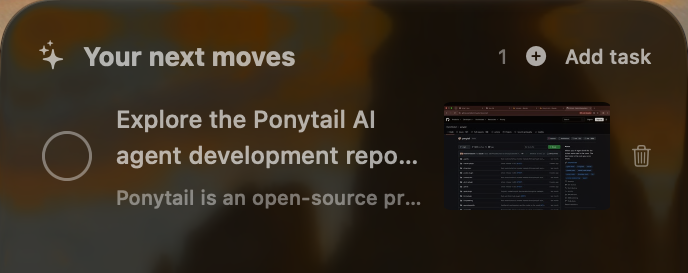

<div align="center">
  
  <h1>Snipstep</h1>
  <p><strong>For the things you screenshot and mean to do.</strong></p>
  <p>A simple macOS to-do list, with the original still attached.</p>
  <p>Created by <a href="https://github.com/Kdevelops00">@Kdevelops00</a></p>
</div>

[Build locally](#build-locally) · [AI setup](docs/AI_SETUP.md) · [Credits](CREDITS.md)

You find a GitHub project you want to try, but you’re halfway through something else. **Take a screenshot and Snipstep puts it on your to-do list with the original attached.** You can also type tasks without a screenshot.



## Keep the context

Press **Control–Option–X** to save the display under your pointer. A sound confirms the save. Open the task to see the original next to your editable title and notes. You can change the shortcut in Settings.



## See what’s left on your desktop

The native To-Do widget shows unfinished tasks. Check one off, or use **Add task** to open the app’s composer. A separate Progress widget and local Analytics show what you’ve finished.



The walkthrough uses a real example from the creator’s Mac. [Screenshot notes and credits](docs/media/README.md).

## Summaries are optional

Text extraction works offline. If you want a suggested title and short summary, configure a supported **LLM API** with your own key, or choose a supported local model.

The app supports its built-in API connection and configurable **OpenAI-compatible Chat Completions endpoints**. It does not support every provider’s proprietary API or every model. You choose whether a custom connection receives image + extracted text or extracted text alone. Saving a new connection turns cloud processing off until you explicitly enable it again. [Exact compatibility and setup](docs/AI_SETUP.md).

There is no product account, backend, subscription, or telemetry SDK. Provider fees and data policies still apply. AI suggestions can be wrong. Originals remain local; enabled cloud requests send the chosen payload to the configured provider. [Privacy](PRIVACY.md).

## Build locally

Snipstep is an MIT-licensed developer preview. Build it from source with Xcode.

The deployment target is macOS 15.2, and the Swift package requires Swift 6. Use full Xcode. See [validation](docs/VALIDATION.md) for the toolchain and machine tested on this revision. Minimum macOS and Intel runtime are still unverified.

Open `SnapLater.xcodeproj`, select **SnapLater → My Mac**, and build/run. The internal project, bundle identifiers, data paths and `snaplater://` scheme retain their development names to preserve existing libraries and widget links. The visible app is Snipstep.

```sh
swift test --parallel --jobs 2
xcodebuild -project SnapLater.xcodeproj -scheme SnapLater \
  -configuration Release -destination 'platform=macOS,arch=arm64' \
  -derivedDataPath build CODE_SIGNING_ALLOWED=NO build analyze
```

For widgets, set your own development team and Apple Development signing identity on both the app and widget targets in Xcode, then build and run the signed app. Both targets must resolve the same team-prefixed app group, `YOURTEAMID.org.snaplater.shared`. The unsigned command above verifies compilation.

Grant Screen Recording for capture. Manual tasks and selected-image import don’t require it. Accessibility and Full Disk Access are not application requirements. Keep the app running for the global shortcut; closing the library window is fine. Add widgets through **desktop → Edit Widgets → Snipstep** after opening the signed app once.

## Status and ownership

Implemented: manual tasks, screenshot context, cached OCR, configurable capture shortcut, optional LLM API/local summaries, embedded settings, native To-Do/Progress widgets, completion, reopening, archive, deletion, and local Analytics.

Not shipped: iPhone app, sync, automatic updates, bundled inference runtime/model weights, or a signed/notarized public installer. Widget scheduling and outer materials are partly controlled by macOS. Supported API formats are tested with synthetic requests/responses; a provider/model combination is not live-verified merely because it accepts that format. [Validation and limits](docs/VALIDATION.md) · [Roadmap](docs/ROADMAP.md).

Created and maintained by **[@Kdevelops00](https://github.com/Kdevelops00)**, with AI-assisted development. Upstream frameworks, runtimes, APIs, and models retain their ownership and terms. [Detailed credits](CREDITS.md) · [Third-party notices](THIRD_PARTY_NOTICES.md).

The project code and original geometric S mark are MIT licensed. Contributions and reproducible reports using fictional content are welcome. [License](LICENSE) · [Contributing](CONTRIBUTING.md) · [Security](SECURITY.md).
